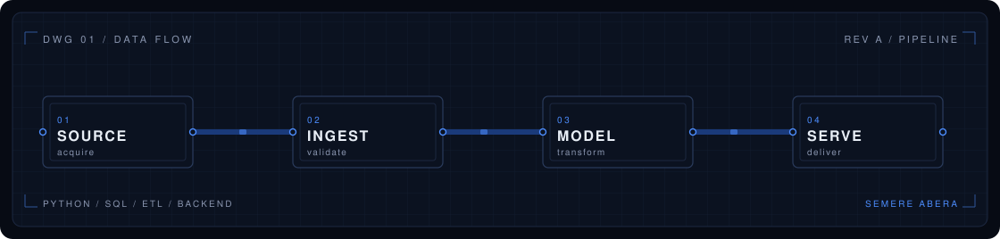

  

# Semere Abera

**Data Engineer | Python, SQL, ETL & Backend Systems**

I design Python pipelines and backend services that acquire data from complex sources, validate it, and deliver it in a form teams can use. Open to **full-time Data Engineer** and **Python / Backend Engineer** roles.

[Portfolio](https://semere-abera.vercel.app/) · [LinkedIn](https://www.linkedin.com/in/semere-abera-75aba726b/) · [Email](mailto:semereabera1111@gmail.com)

---

## Selected engineering work

### [NewlineX](https://github.com/seme555/newlinex)
*Data engineering & ETL*

Batch medallion pipeline: ingest, clean, and aggregate sales data with Airflow, DuckDB, and Delta Lake. Trino for SQL access, Soda for quality checks, Marquez for lineage, Prometheus and Grafana for pipeline health.

### [ScrapForge](https://github.com/seme555/scrapforge)
*Data acquisition & processing*

Distributed scrape-to-API path: Scrapy and Playwright workers, Celery, PostgreSQL, FastAPI. Products and price history land in queryable tables behind a documented REST surface.

### [Crawv](https://github.com/seme555/crawv)
*Asynchronous Python crawling*

Asyncio crawling framework with a Scrapy-like API: spiders, middleware, item pipelines, Redis scheduling, and pluggable HTTP backends (aiohttp, httpx, requests).

### [TaskFlow API](https://github.com/seme555/taskflow-api)
*Backend & distributed tasks*

FastAPI service with a Redis-backed queue, retries with backoff, circuit breaking around external calls, and a live worker dashboard over SSE.

### [CeleryWatch](https://github.com/seme555/celerywatch)
*Monitoring & observability*

Terminal UI for Celery events: live task stream, failure and traceback inspection, and retry from the broker — no application code changes beyond `--events`.

Client delivery stays private. One public write-up: [Large-Scale Real Estate Data Engineering](https://semere-abera.vercel.app/projects/large-scale-real-estate-data-engineering).

---

## Stack

**Languages** — Python, SQL, TypeScript  
**Data engineering** — ETL / ELT, pandas, Airflow, DuckDB, Delta Lake  
**Acquisition** — HTTP clients, Scrapy, Playwright, parsing, validation  
**Backend** — FastAPI, Node.js, PostgreSQL, Redis, Celery, REST APIs  
**Interface** — React, Next.js  
**Delivery** — Docker Compose, GitHub Actions

---

## GitHub activity

  
  

  

  

*Language mix is public repository bytes, not a proficiency ranking.*

---

Addis Ababa
